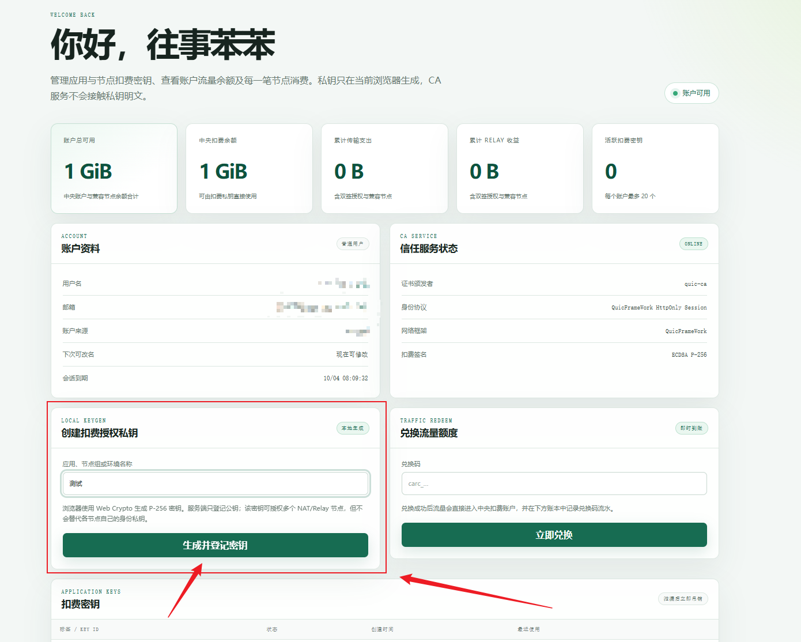
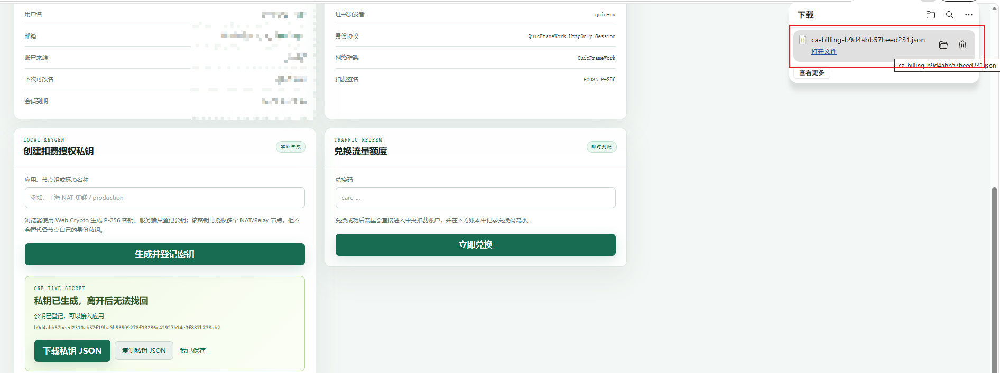
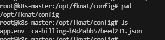
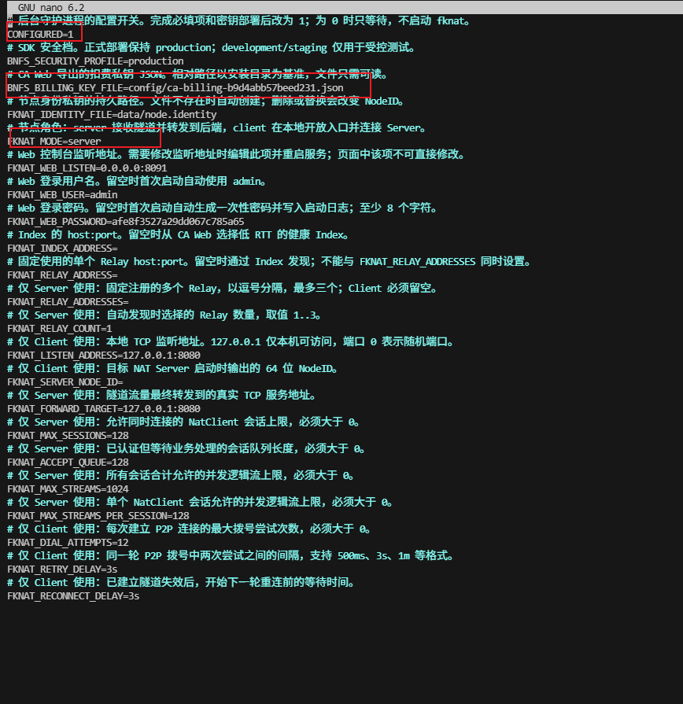
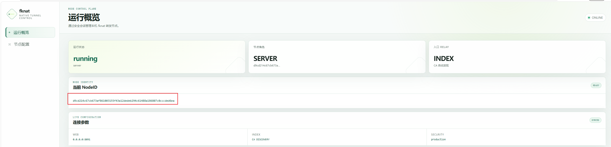
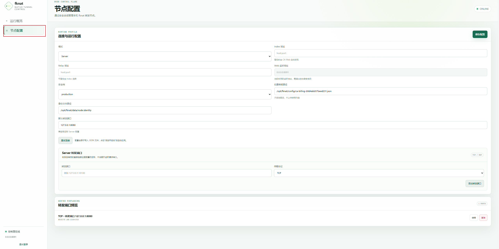
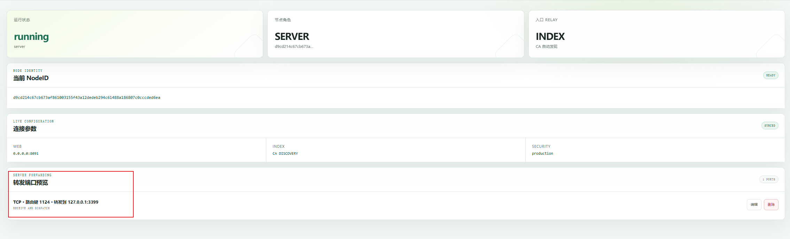
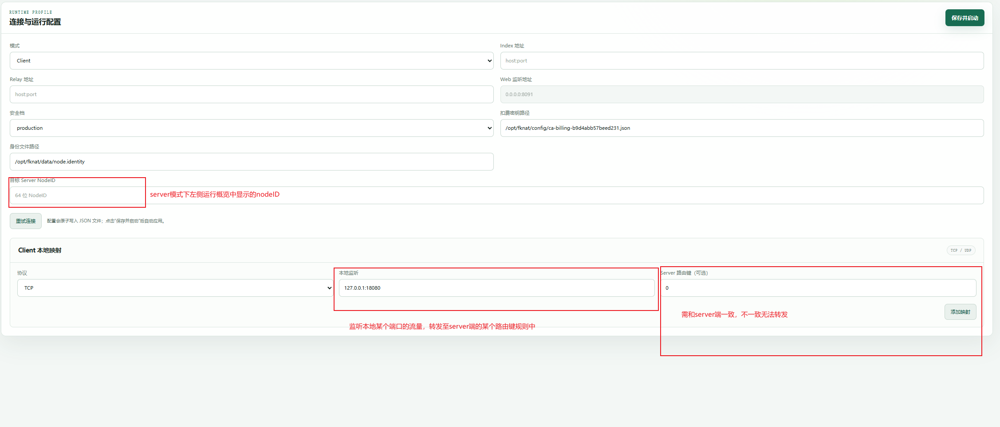
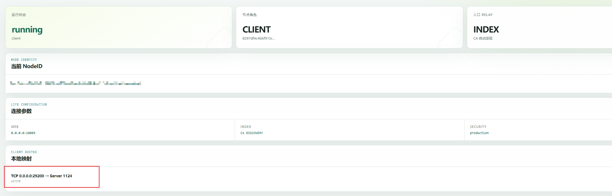
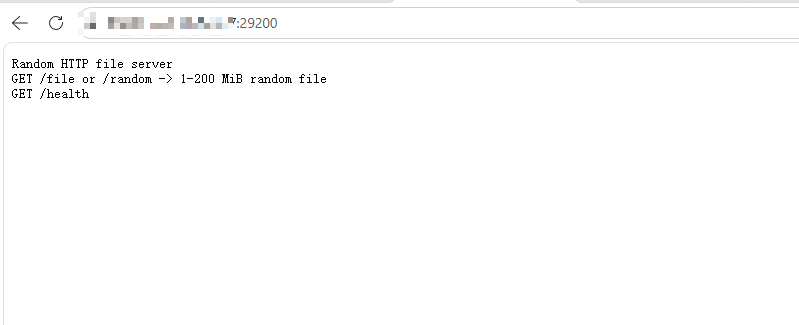

# fknat 快速上手

本指南演示如何完成 **fknat 的安装、扣费密钥配置、Server / Client
节点配置，以及一次完整的端口穿透测试**。

> 本文示例以 Debian / Ubuntu
> 为主。界面和配置项可能随版本更新略有变化，请以当前版本为准。

------------------------------------------------------------------------

## 1. 安装 fknat

前往 Release 页面，下载与你的系统和 CPU 架构对应的安装包。

例如 Debian / Ubuntu 使用 `.deb` 安装包时：

``` bash
dpkg -i fknat_v0.0.2_amd64.deb
```

安装完成后，先不要急着启动服务。首次运行前需要准备
**扣费授权私钥**，并检查 `app.env`。

------------------------------------------------------------------------

## 2. 生成扣费授权私钥

### 2.1 登录 CA Web

登录 [CA Web](https://ca.fknat.top)，在首页找到
**「创建扣费授权私钥」**。



建议填写一个便于识别的名称，例如：

-   `上海 NAT 集群`
-   `家用 Server`
-   `production`

这个名称仅用于帮助你区分不同密钥。

### 2.2 生成并保存私钥

点击 **「生成并登记密钥」**。


生成完成后，页面会显示一次性私钥下载区域。点击 **「下载私钥 JSON」**
并妥善保存。



> \[!IMPORTANT\] **私钥只会在生成时显示一次。**
>
> CA
> 服务端只登记对应的公钥，不会保存你的扣费私钥明文。离开当前页面后将无法再次找回该私钥。
>
> 如果私钥丢失或疑似泄露，请在 CA Web 中禁用对应密钥，并重新生成。

------------------------------------------------------------------------

## 3. 配置扣费私钥

将刚刚下载的私钥 JSON 上传到：

``` text
/opt/fknat/config/
```

例如：

``` text
/opt/fknat/config/ca-billing-b9d4abb57beed231.json
```



然后编辑同目录下的配置文件：

``` bash
cd /opt/fknat/config
nano app.env
```



首次运行至少检查以下配置：

``` dotenv
CONFIGURED=1

BNFS_BILLING_KEY_FILE=ca-billing-b9d4abb57beed231.json

FKNAT_MODE=server

FKNAT_WEB_PASSWORD=你的管理密码
```

各配置项含义：

  ------------------------------------------------------------------------------------------
  配置项                              说明
  ----------------------------------- ------------------------------------------------------
  `CONFIGURED`                        完成必要配置后设置为 `1`。默认值为 `0` 时 fknat
                                      会等待配置完成，不启动。

  `BNFS_BILLING_KEY_FILE`             第 2 步下载的扣费私钥 JSON
                                      文件名。文件可以重命名，但这里必须与实际文件名一致。

  `FKNAT_MODE`                        节点启动角色，可设置为 `server` 或
                                      `client`；启动后也可以在 Web 控制台切换。

  `FKNAT_WEB_PASSWORD`                Web 控制台管理员密码。建议主动配置；默认用户名为
                                      `admin`。密码至少 8 个字符。

  `FKNAT_WEB_LISTEN`                  Web 控制台监听地址，例如 `0.0.0.0:8091`。
  ------------------------------------------------------------------------------------------

> \[!TIP\] `0.0.0.0:8091` 表示 Web 服务监听本机所有 IPv4 网卡的 `8091`
> 端口，并不代表浏览器应该访问
> `0.0.0.0`。远程访问时请使用该机器实际可达的 IP 地址。

------------------------------------------------------------------------

## 4. 启动 fknat

使用 systemd 启动：

``` bash
systemctl start fknat
```

也可以使用：

``` bash
fknat start
```

如果需要确认 systemd 服务状态：

``` bash
systemctl status fknat
```

随后访问 `FKNAT_WEB_LISTEN` 对应的 Web 控制台，并使用：

``` text
用户名：admin
密码：FKNAT_WEB_PASSWORD 中配置的密码
```

登录。

------------------------------------------------------------------------

## 5. 获取 Server NodeID

登录 Web 控制台后，可以在 **「运行概览」 → 「当前 NodeID」**
中看到当前节点的 NodeID。



NodeID 是其他节点定位该节点时使用的标识。

> \[!IMPORTANT\] 请区分 **NodeID** 和节点的 **身份私钥**：
>
> -   NodeID 可以提供给需要连接该节点的人；
> -   身份私钥必须保存在本机并妥善保护，不应分享给其他节点。

如果这台机器准备作为被访问的一端，记录这里的 NodeID，稍后配置 Client
时会使用。

------------------------------------------------------------------------

## 6. 配置 Server

Server 可以把来自 fknat 网络的某个 **Server 路由键** 映射到本机或 Server
可访问的 TCP / UDP 服务。

进入：

**「节点配置」 → 模式选择 `Server`**



### 6.1 添加 Server 转发端口

在 **「Server 转发端口」** 中填写：

-   **转发端口**：Server 最终要访问的目标地址，例如 `127.0.0.1:8080`
-   **传输协议**：选择 `TCP` 或 `UDP`
-   **Server 路由键**：用于让 Client 指定这一条转发规则

例如：

``` text
协议：TCP
Server 路由键：1124
转发目标：127.0.0.1:3399
```

其含义是：

``` text
Client 请求路由键 1124
          │
          ▼
      fknat 网络
          │
          ▼
       Server
          │
          ▼
127.0.0.1:3399
```

配置完成后，可以在 **「转发端口预览」** 中确认最终规则。



> 当前一个 Server 路由键对应一个目标 `IP:Port`。请确保 Client
> 使用的路由键与 Server 上实际存在的路由键完全一致。

------------------------------------------------------------------------

## 7. 配置 Client

另一台机器切换到：

**「节点配置」 → 模式选择 `Client`**



Client 侧主要需要配置三项：

### 7.1 目标 Server NodeID

填写第 5 步中 Server Web 控制台显示的 NodeID。

### 7.2 本地监听地址

这是 Client 本机应用最终访问的地址，例如：

``` text
0.0.0.0:29200
```

表示 Client 在本地监听 `29200` 端口。

如果只希望本机访问，也可以监听：

``` text
127.0.0.1:29200
```

### 7.3 Server 路由键

填写 Server 上对应转发规则的路由键。

例如 Server 配置的是：

``` text
路由键：1124
目标：127.0.0.1:3399
```

那么 Client 也必须填写：

``` text
Server 路由键：1124
```

最终链路为：

``` text
访问 Client:29200
        │
        ▼
      Client
        │
        │ NodeID + 路由键 1124
        ▼
   fknat / Relay
        │
        ▼
      Server
        │
        │ 路由键 1124
        ▼
127.0.0.1:3399
```

------------------------------------------------------------------------

## 8. 完整测试示例

下面使用一组实际配置验证链路。

### Server

Server 的 `3399` 端口已经运行了一个简单的 HTTP 服务，并配置：

``` text
协议：TCP
Server 路由键：1124
转发目标：127.0.0.1:3399
```


### Client

Client 配置：

``` text
协议：TCP
本地监听端口：29200
目标 Server：上面的 Server NodeID
Server 路由键：1124
```



此时访问 Client 所在机器的：

``` text
http://<Client-IP>:29200
```

请求会沿下面的路径转发：

``` text
浏览器
   │
   ▼
Client:29200
   │
   ▼
fknat 网络 / Relay
   │
   ▼
Server
   │
   ▼
127.0.0.1:3399
   │
   ▼
HTTP 服务
```

如果页面正常返回，说明 Client → fknat → Server →
目标服务的链路已经建立成功。



------------------------------------------------------------------------

## 9. 连接失败时优先检查

遇到无法连接时，建议按以下顺序排查：

1.  **Server 是否处于 `running` 状态**，NodeID 是否填写正确。
2.  **Client 与 Server 的 Server 路由键是否完全一致**。
3.  Server 的转发目标 `IP:Port` 是否确实存在服务并能从 Server 本机访问。
4.  Client 的本地监听端口是否已经被其他程序占用。
5.  `BNFS_BILLING_KEY_FILE` 是否指向正确的私钥 JSON，文件是否位于
    `/opt/fknat/config/`。
6.  `CONFIGURED` 是否已经设置为 `1`。
7.  Web 控制台的 **「转发端口预览」** 是否与预期一致。

------------------------------------------------------------------------

## 10. 最短配置流程

如果你已经理解各配置项，可以按照下面的顺序快速完成部署：

``` text
安装 fknat
   ↓
CA Web 生成并下载扣费私钥
   ↓
私钥放入 /opt/fknat/config/
   ↓
修改 app.env
   ↓
CONFIGURED=1
   ↓
启动 fknat
   ↓
Server 获取 NodeID
   ↓
Server 创建 路由键 → 目标 IP:Port
   ↓
Client 填写 Server NodeID
   ↓
Client 创建 本地端口 → Server 路由键
   ↓
访问 Client 本地端口
   ↓
完成
```
